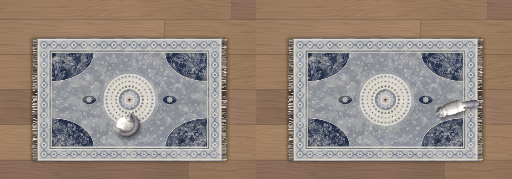
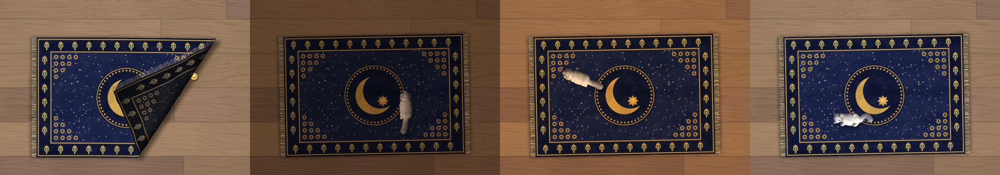
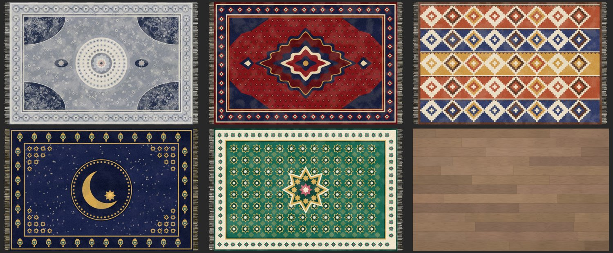
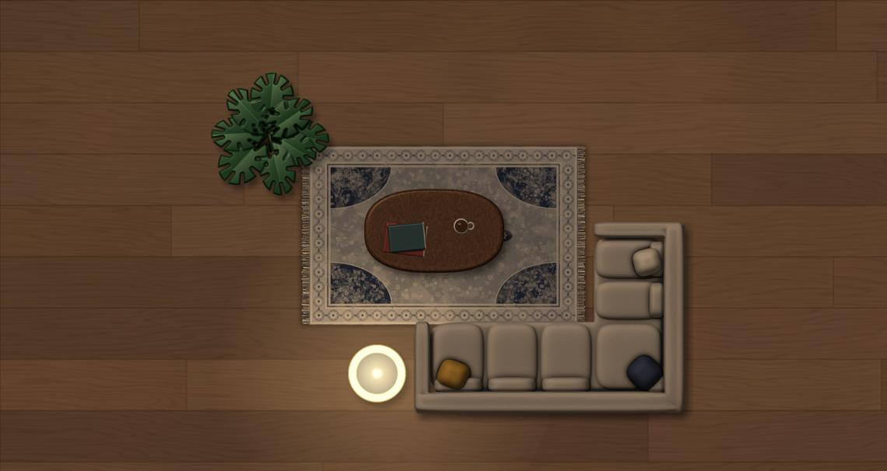

# Windows Rug

**Hide desktop clutter under a rug.** Windows Rug puts a cloth-simulated vintage Persian rug on your Windows desktop. You can drag it over messy icons, flip a corner back to reach what's underneath, and watch it drape and settle like real fabric.


[العربية](README.ar.md)

## Features

- **Real cloth physics.** The rug is a mesh of about 750 particles. It has gravity, friction against the desk, and self-collision, so folds stack instead of passing through each other. Grab any point and the rug drags along behind your cursor. It wrinkles where it's pulled and settles when you let go.
- **Behaves like a real rug.** It's heavy and stiff rather than floppy: lift a corner and it curls over, let go and it flops back open, just like the real thing. However you leave it, it relaxes flat on the desk and never ends up as a tangled heap.
- **Sweep it under the rug.** One click gathers every desktop icon into a neat pile under the rug, then lifts the rug and drops it back over them. Another click puts every icon back where it was.
- **A cat comes to visit.** Every few minutes a fluffy cat wanders onto the rug. Sometimes it curls up for a nap, sometimes it crawls underneath and you see a lump moving across the rug. Other times it jumps onto the sofa for a nap, or onto the coffee table, where it walks to the mug and knocks it onto the floor. Click the spilled mug to put it back. Click the cat, or grab the rug, and it bolts. You can turn the cat off in the menu.
- **Dust puffs.** The rug kicks up a little dust when it slaps down on the desk.
- **Drop files under the rug.** Drag any desktop file onto the rug and it slips underneath.
- **Five designs and three floors.** Vintage grey, classic red, kilim, Ramadan and Eid rugs, on oak, dark walnut or light ash, or use any picture of your own for the rug or the floor.
- **More than one rug.** Add as many rugs as you like, each with its own design.
- **Day and night.** The light shifts through the day: cool dawn, white noon, a golden evening and a lamp-lit night, on both the rug and the floor.
- **Seasons.** During Ramadan the rug turns into a Ramadan rug with lanterns and a crescent, at Eid into an Eid rug, and in winter snow drifts in along the floor's edges. This follows the Hijri calendar automatically.
- **Lost things under the rug.** Lift a corner, or drag the rug away, and you may find a coin, a key, a lone sock... They stay on the floor where they were; click one to pick it up. A new handful turns up every day.
- **Laser pointer.** Press **Ctrl+Alt+L** and the cursor becomes a red dot the cat chases and pounces on.
- **Pet the cat.** Hover over the napping cat and it stretches, then rolls onto its back.
- **Robot vacuum.** Now and then a little robot vacuum tours the desk and bumps into the rug's edges. It tidies up too: it picks up desktop icons lying around, carries them to the nearest rug and pushes them underneath. It also vacuums up any lost things left in the open. Sometimes the cat rides it.
- **A living room.** A corner sofa, a coffee table with a mug of coffee, a floor lamp and a monstera, all seen from above and lit like the rug. Drag them anywhere; right-click to make them bigger or smaller, turn them or remove them. The rug always stays underneath the furniture, and the cat always walks on top. Click the lamp to switch it on, and its warm light falls on the floor and the rug.
- **Never lost.** A tray icon and **Ctrl+Alt+R** bring every rug back in front of you. If anything ever goes wrong, the rug resets itself instead of vanishing, and the error is written to `%APPDATA%\WindowsRug\error.log`.
- **Lit and shaded in real time.** A small software rasterizer draws the woven texture with per-vertex lighting. It also draws soft drop shadows, shadows cast by folded layers, and a duller underside.
- **Lives on the desktop layer.** The rug sits above your icons and below every app window. It stays put when you press Win+D, and it doesn't show up in the taskbar or in Alt+Tab.
- **Zero cost when idle.** The simulation runs only while the rug is moving. Once it settles, the timer stops, the process sits at 0% CPU, and its working set is trimmed.
- **Nothing to download.** The installer compiles a small native `WindowsRug.exe` with the C# compiler that ships with Windows (.NET Framework 4.x).
- **Remembers its shape.** Position, size and every fold are restored the next time you sign in.
- **Wood-floor wallpaper included.** It's a calm, low-contrast plank texture, so the desktop stays easy on the eyes.

| Drag it along | Lift a corner and let go |
|---|---|
|  |  |









**Double-click to shake it out:** however crumpled the rug is, it lifts, slides apart and lands flat again.


## Install

1. Download `WindowsRug.zip` from the [latest release](../../releases/latest) and extract it.
2. Double-click **`Install.bat`**.

The installer:
- builds `WindowsRug.exe` into `%LOCALAPPDATA%\WindowsRug`
- sets the wood-floor wallpaper
- adds the rug to your Startup folder
- launches the rug

> If SmartScreen shows "Windows protected your PC", click **More info**, then **Run anyway**. The scripts are plain text, so you can read them before running.

## Usage

| Action | Result |
|---|---|
| Click and drag anywhere on the rug | Pulls the rug along like cloth |
| Lift a corner | Peek at the icons underneath; let go and the corner flops back down |
| Double-click | Shakes the rug out and smoothly unfolds it flat, wherever it lies |
| Click the cat | It runs off |
| Hover over the napping cat | It stretches and rolls over |
| Drag a desktop file onto the rug | It goes under the rug |
| Ctrl+Alt+L | Laser pointer on or off |
| Ctrl+Alt+R, or click the tray icon | Bring every rug back into view |
| Click the lamp | On / off |
| Drag furniture, right-click it | Move it; make it bigger or smaller, turn or remove it |
| Right-click | **Sweep icons under the rug** · **Put icons back** · **Flatten** · **Bigger** · **Smaller** · **Rotate** · **Rug design** · **Floor** · **New rug** · **Remove this rug** · **Room** · **Laser** · **Cat** · **Robot vacuum** · **Robot tidies icons** · **Breeze** · **Day and night** · **Seasons** · **Close** |

> To sweep icons under the rug, **Auto arrange icons** must be off: right-click the desktop → **View**. If **Align icons to grid** is on, Windows may nudge some icons back onto its grid later.

## Uninstall

Double-click **`Uninstall.bat`**. This stops the rug, removes it from Startup, and deletes its files and saved state. Your wallpaper is left as it is; you can change it in **Settings → Personalization**.

## Requirements

- Windows 10 or 11
- .NET Framework 4.x (built into Windows 10 and 11)

## How it works

| Part | Details |
|---|---|
| Physics | Verlet integration with position-based constraints: structural, shear and bend springs (10 solver iterations, 2 substeps per frame). Coulomb-style static and kinetic friction grips the desk, while rug-on-rug contact is slick. Once released, a gentle best-fit pull toward the flat layout (the rug's "memory") lets folds flop back open. A spatial hash handles self-collision between non-neighbouring particles. Unfolding uses a best-fit (Procrustes) rotation of the flat layout and blends kinematically into it. |
| Rendering | Textured triangle rasterization into a premultiplied BGRA buffer, with bilinear sampling and Gouraud lighting, and a per-pixel depth buffer so only the topmost layer shows. A half-resolution shadow map gives box-blurred soft shadows and layered self-shadowing. |
| Window | A per-pixel-alpha layered window (`UpdateLayeredWindow`). Transparent pixels are click-through. The window is owned by `Progman` and pinned to the bottom of the Z-order with `WM_WINDOWPOSCHANGING`. |
| Cat | Pre-rendered sprites (8 walk frames and a curled-up nap), drawn over a cached copy of the rug frame so the rug isn't re-rendered. While it naps the process sleeps; a timer wakes it when the nap ends. Under the rug, it raises the desk locally and the cloth drapes over the lump. |
| Icons | The desktop is a list view inside Explorer. Positions are set with `LVM_SETITEMPOSITION`; names and positions are read through a small block of Explorer's memory and saved to `%APPDATA%\WindowsRug\icons.txt` so they can be put back. |
| Light and seasons | A clock tick every 5 minutes picks the light colour in 20-minute steps and the season (Hijri dates via `UmAlQuraCalendar`). Only when either changes is the wallpaper re-tinted and the rugs redrawn once. |
| Robot, laser | Separate small layered windows that run only while active. The robot asks each rug and piece of furniture for a hit test and pokes the cloth where it bumps. Icons it tidies are moved live with `LVM_SETITEMPOSITION`. |
| Room | Every piece of furniture is a static layered window: it costs nothing until you move it. A lamp that is on adds a click-through glow window and a point light the rug renderer uses. Windows are kept in a fixed order (cat, furniture, robot, rugs, lost items, light) just above the desktop icons; clicks never reorder them. |
| Idle | Every frame measures the largest particle movement. After 40 calm frames the timer stops and the state is saved to `%APPDATA%\WindowsRug\state.txt`. A watchdog adds damping if the rug keeps moving and puts it to sleep within about 7 seconds of being let go, whatever its shape. |

## Project layout

```
rug/
  Rug.cs            simulation, renderer and desktop window (C# 5, single file)
  Install.ps1/.bat  build the exe, set wallpaper, add to Startup
  Uninstall.ps1/.bat
  rugs/*.png        rug designs
  floors/*.jpg      floor wallpapers
  cat.png           cat sprite sheet
  items.png         things lost under the rug
  robot.png         robot vacuum
  furniture/*.png   sofa, table, lamp (off/on), plant
  wood.jpg          wallpaper
tools/
  make_assets.py    procedurally generates rug.png and wood.jpg (Python 3, Pillow, NumPy)
  make_cat.py       renders the cat sprite sheet from a lit height-field model
  make_props.py     renders the lost items and the robot vacuum
  make_furniture.py renders the living-room furniture
```

## Building manually

```powershell
Add-Type -TypeDefinition (Get-Content rug\Rug.cs -Raw -Encoding UTF8) `
    -ReferencedAssemblies System.Windows.Forms, System.Drawing `
    -OutputAssembly WindowsRug.exe -OutputType WindowsApplication
```

Copy `rugs/`, `floors/`, `furniture/`, `cat.png`, `items.png` and `robot.png` next to the exe and run it.

## License

[MIT](LICENSE)
