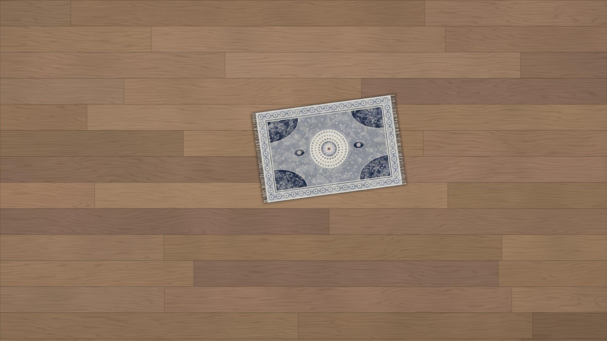
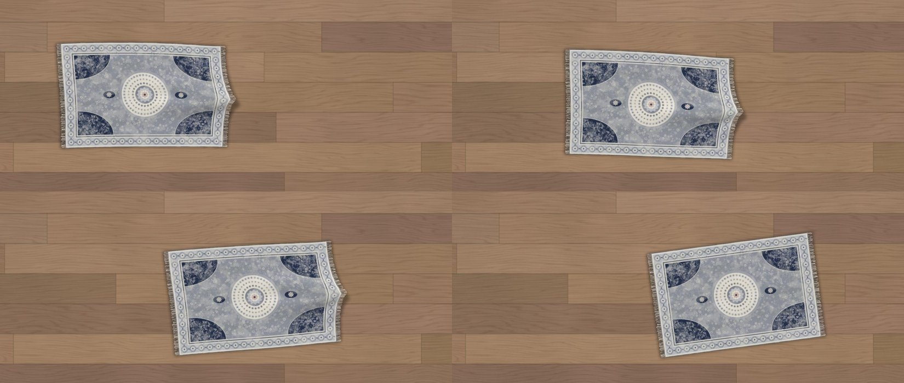
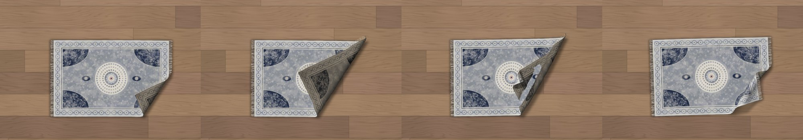
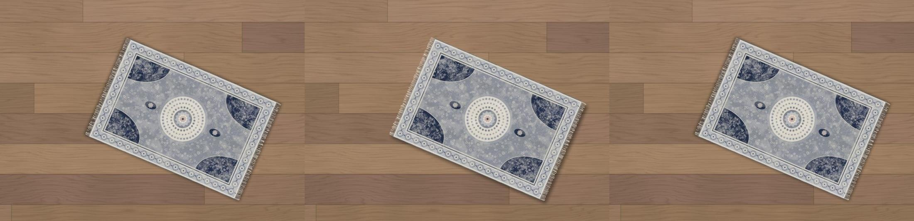

# Windows Rug

**Hide desktop clutter under a rug.** Windows Rug puts a cloth-simulated vintage Persian rug on your Windows desktop. You can drag it over messy icons, flip a corner back to reach what's underneath, and watch it drape and settle like real fabric.



[العربية](README.ar.md)

## Features

- **Real cloth physics.** The rug is a mesh of about 750 particles. It has gravity, friction against the desk, and self-collision, so folds stack instead of passing through each other. Grab any point and the rug drags along behind your cursor. It wrinkles where it's pulled and settles when you let go.
- **Behaves like a real rug.** It's heavy and stiff rather than floppy: lift a corner and it curls over, let go and it flops back open, just like the real thing. However you leave it, it relaxes flat on the desk and never ends up as a tangled heap.
- **Lit and shaded in real time.** A small software rasterizer draws the woven texture with per-vertex lighting. It also draws soft drop shadows, shadows cast by folded layers, and a duller underside.
- **Lives on the desktop layer.** The rug sits above your icons and below every app window. It stays put when you press Win+D, and it doesn't show up in the taskbar or in Alt+Tab.
- **Zero cost when idle.** The simulation runs only while the rug is moving. Once it settles, the timer stops, the process sits at 0% CPU, and its working set is trimmed.
- **Nothing to download.** The installer compiles a small native `WindowsRug.exe` with the C# compiler that ships with Windows (.NET Framework 4.x).
- **Remembers its shape.** Position, size and every fold are restored the next time you sign in.
- **Wood-floor wallpaper included.** It's a calm, low-contrast plank texture, so the desktop stays easy on the eyes.

| Drag it along | Lift a corner and let go |
|---|---|
|  |  |

**Double-click to shake it out:** however crumpled the rug is, it lifts, slides apart and lands flat again.



## Install

1. Download `WindowsRug.zip` from the [latest release](../../releases/latest) and extract it.
2. Double-click **`Install.bat`**.

The installer:
- builds `WindowsRug.exe` into `%LOCALAPPDATA%\WindowsRug`
- sets the wood-floor wallpaper
- adds the rug to your Startup folder
- launches the rug

> If SmartScreen shows "Windows protected your PC", click **More info**, then **Run anyway**. The scripts are plain text, so you can read them before running.

## Usage

| Action | Result |
|---|---|
| Click and drag anywhere on the rug | Pulls the rug along like cloth |
| Lift a corner | Peek at the icons underneath; let go and the corner flops back down |
| Double-click | Shakes the rug out and smoothly unfolds it flat, wherever it lies |
| Right-click | **Bigger** · **Smaller** · **Rotate** · **Breeze** (an edge occasionally lifts on its own) · **Close** |

## Uninstall

Double-click **`Uninstall.bat`**. This stops the rug, removes it from Startup, and deletes its files and saved state. Your wallpaper is left as it is; you can change it in **Settings → Personalization**.

## Requirements

- Windows 10 or 11
- .NET Framework 4.x (built into Windows 10 and 11)

## How it works

| Part | Details |
|---|---|
| Physics | Verlet integration with position-based constraints: structural, shear and bend springs (10 solver iterations, 2 substeps per frame). Coulomb-style static and kinetic friction grips the desk, while rug-on-rug contact is slick. Once released, a gentle best-fit pull toward the flat layout (the rug's "memory") lets folds flop back open. A spatial hash handles self-collision between non-neighbouring particles. Unfolding uses a best-fit (Procrustes) rotation of the flat layout and blends kinematically into it. |
| Rendering | Textured triangle rasterization into a premultiplied BGRA buffer, with bilinear sampling and Gouraud lighting, and a per-pixel depth buffer so only the topmost layer shows. A half-resolution shadow map gives box-blurred soft shadows and layered self-shadowing. |
| Window | A per-pixel-alpha layered window (`UpdateLayeredWindow`). Transparent pixels are click-through. The window is owned by `Progman` and pinned to the bottom of the Z-order with `WM_WINDOWPOSCHANGING`. |
| Idle | Every frame measures the largest particle movement. After 40 calm frames the timer stops and the state is saved to `%APPDATA%\WindowsRug\state.txt`. A watchdog adds damping if the rug keeps moving and puts it to sleep within about 7 seconds of being let go, whatever its shape. |

## Project layout

```
rug/
  Rug.cs            simulation, renderer and desktop window (C# 5, single file)
  Install.ps1/.bat  build the exe, set wallpaper, add to Startup
  Uninstall.ps1/.bat
  rug.png           rug texture
  wood.jpg          wallpaper
tools/
  make_assets.py    procedurally generates rug.png and wood.jpg (Python 3, Pillow, NumPy)
```

## Building manually

```powershell
Add-Type -TypeDefinition (Get-Content rug\Rug.cs -Raw -Encoding UTF8) `
    -ReferencedAssemblies System.Windows.Forms, System.Drawing `
    -OutputAssembly WindowsRug.exe -OutputType WindowsApplication
```

Copy `rug.png` next to the exe and run it.

## License

[MIT](LICENSE)
